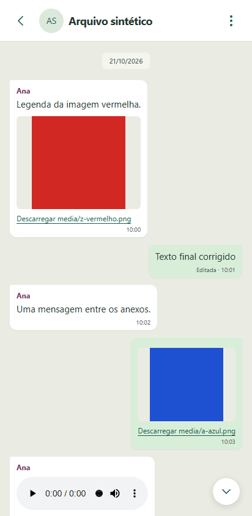

# Chat Archive

[Open Chat Archive](https://tiagosantos16.github.io/Whatsapp-export-viewer/)

Keep WhatsApp chat exports on your device and read them offline. Import a TXT or ZIP, choose which participant is you, and return to your conversations without selecting the files again.

The interface is in Portuguese (Portugal). No account, backend, analytics or conversation uploads.



## Features

- Android and iPhone exports, including multiline messages and attachment references.
- Local storage for conversations, images, audio, video and documents.
- Search across the archive or within a conversation, date navigation and saved reading position.
- Conservative overlap matching when adding another export, keeping uncertain records.
- ZIP backup and restore, light and dark themes, and offline startup after preparation.

## Install on Android

Open the site in Chrome, choose **Instalar aplicação**, then use Chrome's install option if prompted. If no prompt appears, use **Install app** or **Add to Home screen** in the browser menu. Select an export saved on your phone, or restore a backup on the phone itself.

Keep the same site address for updates. Data saved on your computer does not appear on your phone automatically.

## Run and test

Use Node.js 24 and npm:

```sh
npm ci
npm run dev
```

For checks and a production preview:

```sh
npm run typecheck
npm run test
npx playwright install chromium
npm run test:e2e
npm run build
npm run preview
```

Tests use synthetic data, including generated media and a 50,000-message conversation. Production preview is needed to test offline behavior.

## Publish on GitHub Pages

In **Settings > Pages**, select **GitHub Actions**. Run **Publish GitHub Pages** from the Actions tab. It builds with the repository's base path and publishes only `dist`; deployment is manual, not triggered by push.

The landing page lives at the site root and the PWA at `app/`. For local testing under a repository prefix, set `BASE_PATH=/repository-name/` before building.

## Privacy and limitations

Messages and attachments stay in browser storage. The host receives requests for public app files, without conversation content. Opening an external link connects to that website.

**Keep your original exports and an external backup.** Storage and backups are not encrypted by the app. Clearing site data, browser eviction or losing the device can remove the archive. Save and restore backups in the app's settings.

Exports cannot recover missing attachments, delivery states, reply links or edit history. Chat Archive cannot import messages back into WhatsApp. Ambiguous overlaps may remain as duplicates; media playback depends on the browser and device.

Original code is [MIT licensed](LICENSE). See [dependency notices](THIRD_PARTY_NOTICES.md), [security notes](SECURITY.md) and [contributing](CONTRIBUTING.md).

Independent project, not affiliated with WhatsApp or Meta.
